# Turbo Trail

Coding agents: read [AGENTS.md](AGENTS.md) before making changes.

A browser kart racer built with Three.js. Race five rivals across twelve courses, drift for mini-turbos, use items, and play solo or online. Choose from six characters; keyboard, touch, and gamepad controls are supported.

## Screenshots

| Windmill Wilds | Neon Harbor |
| --- | --- |
|  | 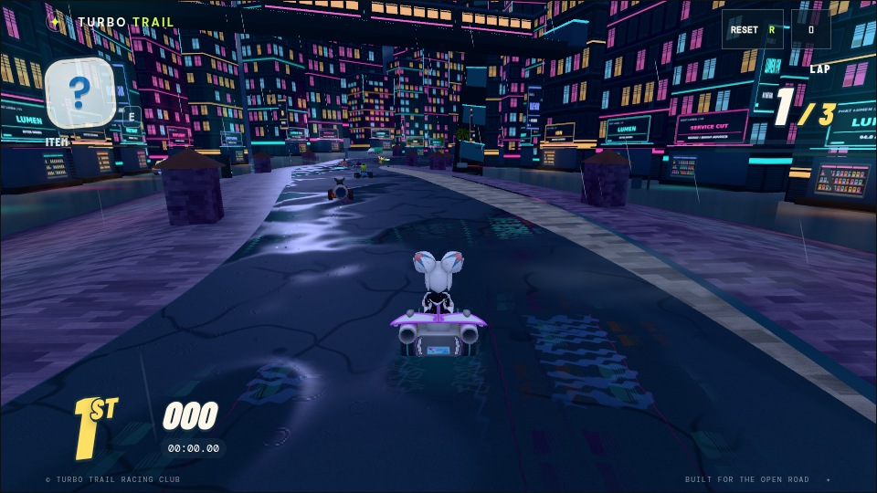 |
| **Sunstone Ruins** | **Frostpeak Festival** |
| 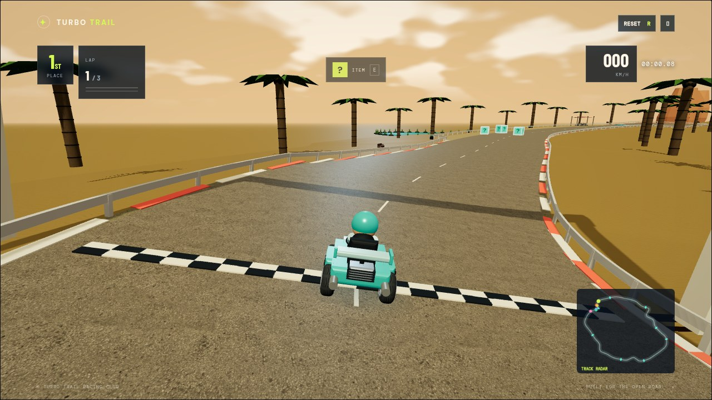 | 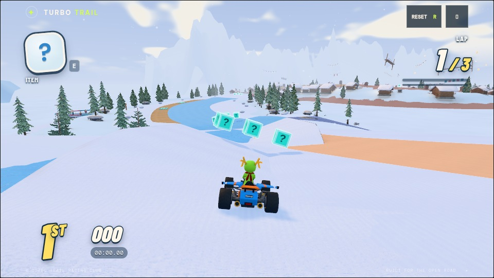 |
| **Clockwork Citadel** | **Paper Revel** |
| 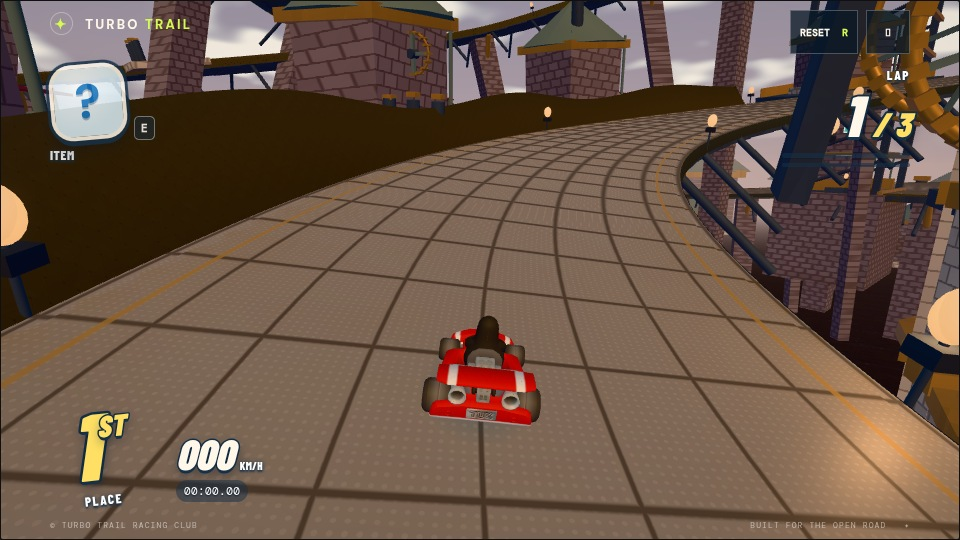 | 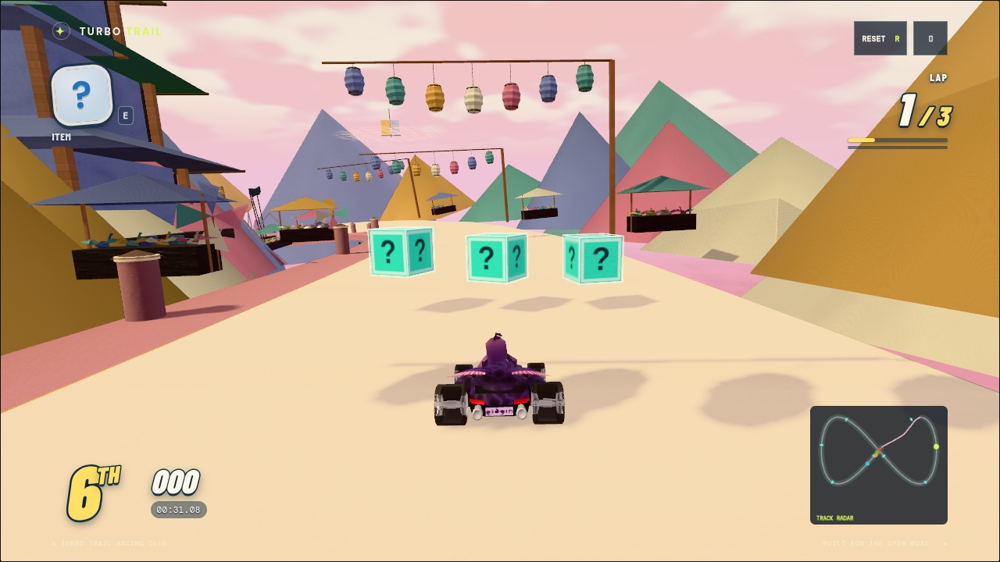 |
| **Tempest Causeway** | **Pocket Pantry** |
| 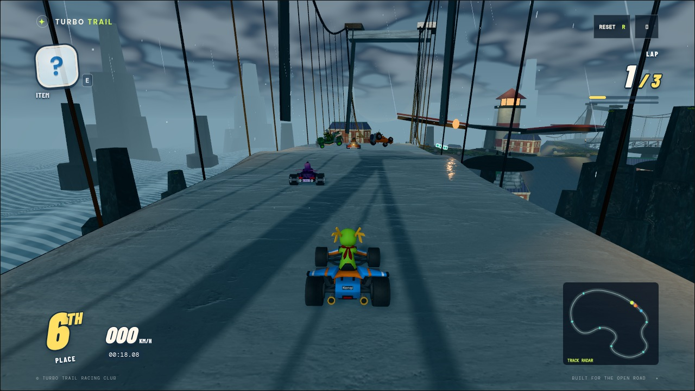 | 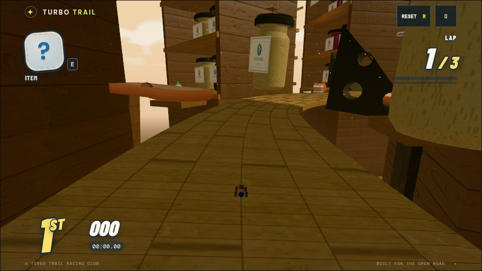 |
| **Railstorm Express** | **Metronome Hall** |
| 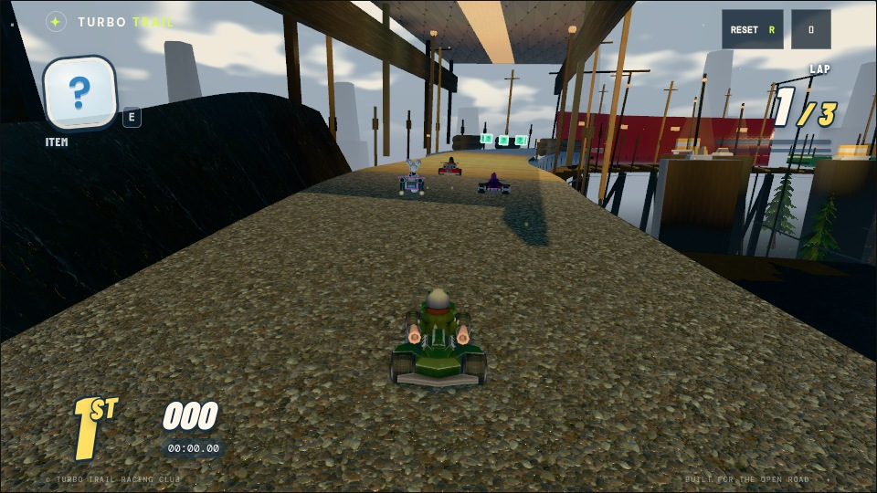 | 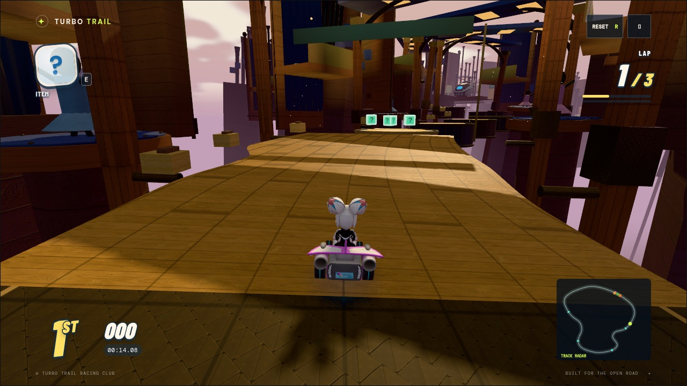 |
| **Pelagic Glasshouse** | **Emberwing Observatory** |
| 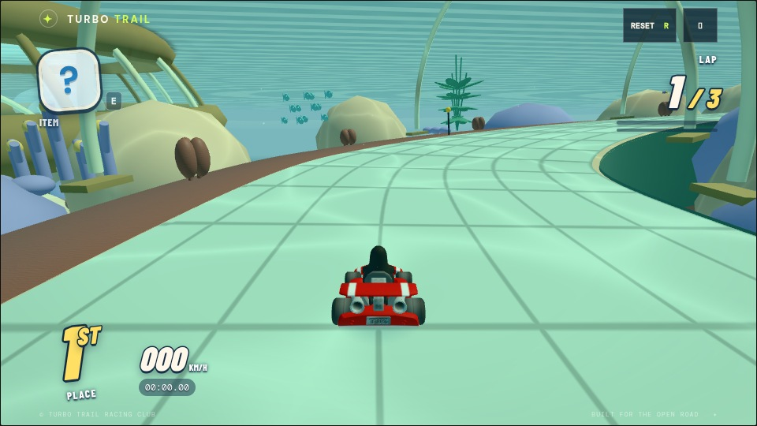 | 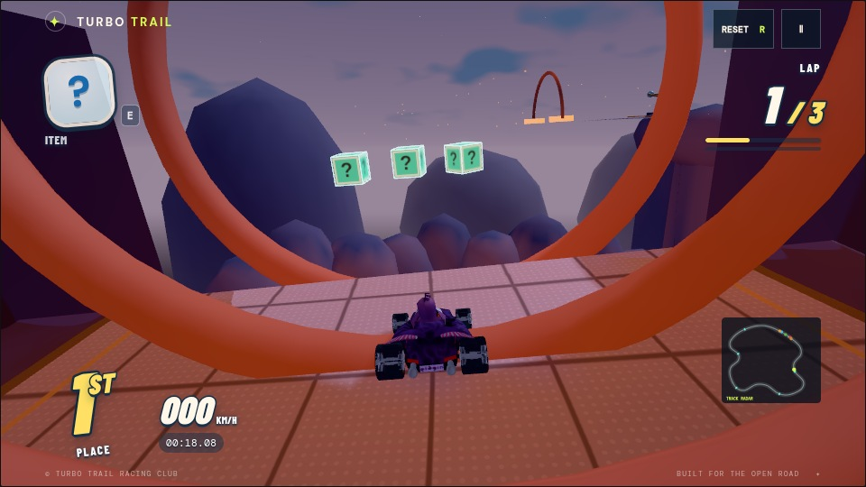 |

## Run locally

Requires Node.js 22+ and npm.

```sh
npm ci
npm start
```

Open [http://127.0.0.1:5173](http://127.0.0.1:5173). Assets are bundled; no build step is needed.

## Multiplayer

Select **Multiplayer**, then host a room or join with its six-character code. Internet play requires deploying the Node server with HTTPS and WebSocket forwarding for `/multiplayer`; a static host such as GitHub Pages supports solo play only. Set `PORT` and `HOST` to configure the listener (defaults: `5173` and `0.0.0.0`).

## Controls

| Action | Key |
| --- | --- |
| Accelerate | W / ↑ |
| Brake / reverse | S / ↓ |
| Steer | A / D or ← / → |
| Drift / ramp trick | Space or Shift |
| Use item | E / Enter |
| Pause | Esc |
| Recover | R |

Touch devices steer by sliding on the race view; use a second finger for drift, brake, or items.

## Tests

```sh
npm test
```

For interactive checks, start the server and open [http://127.0.0.1:5173/tests/browser.html](http://127.0.0.1:5173/tests/browser.html).

## Credits and project docs

See [asset credits](assets/CREDITS.md) and the license files under `assets/` and `vendor/`. More detail: [course experiences](docs/course-experiences.md), [architecture](docs/architecture.md), [graphics](docs/graphics.md), and [screenshot capture](docs/screenshot-capture.md).
