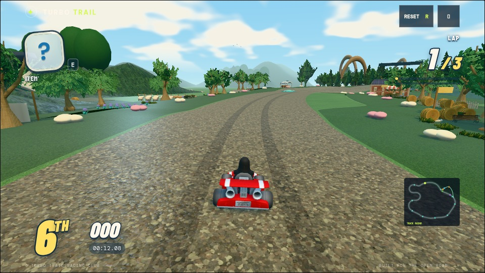
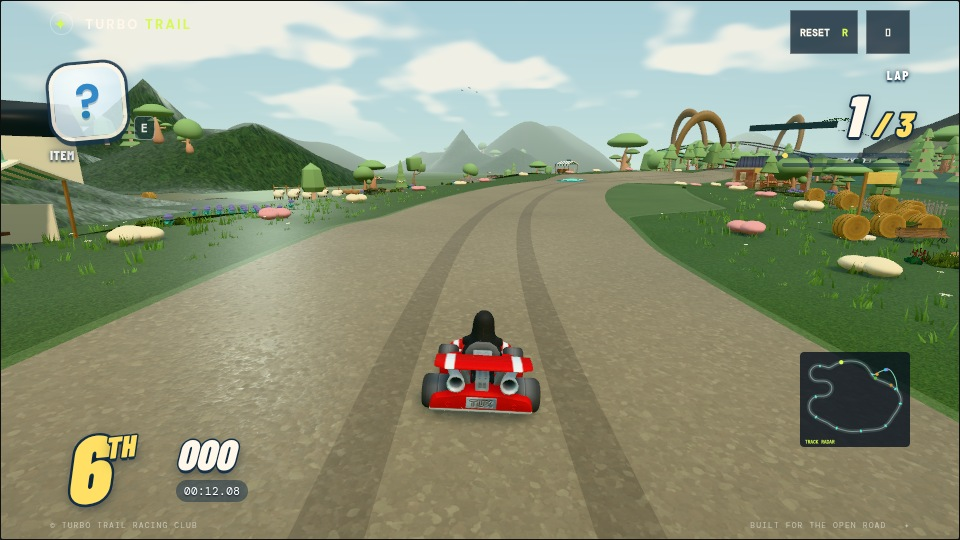

# Graphics tuning

## Windmill contact shading

Windmill Wilds enables Three.js r180 GTAO on High and Ultra. The vendored
`GTAOShader` and `PoissonDenoiseShader` are covered by `vendor/three/LICENSE`;
their only import change points at the bundled Three.js module.
The main HDR target resolves its multisampled depth to a texture. Normals are
reconstructed from that depth, avoiding an additional scenery/normal draw pass.
Two half-resolution fullscreen passes calculate and denoise AO; their longest
axis is capped at 640 pixels on High and 960 on Ultra. Depth-aware upsampling
reduces silhouette halos, the radius is 1.15 world metres, and the contribution
fades out from 35 to 75 metres. The restrained 0.4 blend supplements baked
visibility without heavily darkening already shaded scenery. Bloom is added
after AO so highlight glow retains its intensity.

The meadow contact-shading checkbox disables the effect independently of bloom.
Performance and Balanced release the AO targets, noise and depth texture.
Other courses retain their existing postprocessing. The effect has no temporal
history, and fixed cameras/race clocks produce repeatable paused frames.
Run `node tools/check-meadow-gtao.mjs` for real WebGL checks of contact shading,
sky preservation, resize, quality switches, draw count and disposal. Software
Chromium verifies correctness; GPU frame-time cost requires player hardware.

## Meadow vegetation, materials and lighting bake

Blossom Common, Cider Orchard and Harvest Homecoming have regional opaque
grass-blade instances with shaded roots, varied placement, distance taper and
race-clock wind. One additional instanced draw supplies small daisies with
modeled stems, petals and pollen centers. Plants are grounded against the
rendered embankments and excluded from the driving surfaces and branch routes.
They receive live sun shadows and sample the static ground-lighting atlas, but
do not cast their own shadows or enter the offline obstruction bake. This keeps
grass movement independent of a static bake and bounds shadow submission cost.

The four tiers retain 35%, 55%, 80% and 100% of each grass region respectively.
Performance/Balanced taper from 35 to 60 metres; High/Ultra from 55 to 85 metres.
Fine grass is actual geometry, with no transparent grass-card overdraw.
The scanned earth path retains small relief and tire ruts with lower albedo
contrast. Grass textures have quieter contrast and normals. A softer sky,
warm sun and greener ground fill replace the old blue shadow tint. Windmill's
existing imported racers retain their proportions and colors, with separate
roughness for tires, wheel hardware and painted/cloth surfaces.

The regenerated bake uses 1024px ground atlases and 48 hemisphere samples,
plus 32 samples for each static mesh receiver. The previous settings were
768px/12 samples and 8 mesh samples. This is offline BVH ambient visibility and
local diffuse bounce, not the four-bounce Cycles solver used by Sunstone.
Direct sunlight remains live, avoiding duplicate sun shadows. At the meadow
capture, matching mesh-bake coverage improves from 71.4% to 92.4%; unmatched
objects still use the spatial ground fallback. Ground and mesh manifests share
the exported scene digest, and output hashes are validated by the lighting tests.

Regenerate this course with:

```sh
LIGHTING_BAKE_SIZE=1024 LIGHTING_BAKE_SAMPLES=48 MESH_LIGHT_BAKE_SAMPLES=32 \
  node tools/bake-all-lighting.mjs windmill-wilds
```

Run `node tools/check-meadow-gtao.mjs --level` to also exercise the actual meadow
at all four tiers, AO on/off, paused frames, resize and later course sectors.
`tests/meadow-graphics.test.js` checks plant clearance, grounding, density,
wind clocks, baked-light binding and preference persistence.
The complete suite retains an existing Metronome orchestra failure at
`tests/metronome-orchestra.test.js:132` (mallet/drumhead contact), reproduced on
the original `df899fe` commit. Meadow checks, lint and formatting pass.

The views below use the same 960×540 chase camera at progress 0.045 and race
time 12.08 seconds, High, with adaptive quality disabled. Random rival/item
events can differ; these are appearance comparisons, not GPU benchmarks.
At this view, rendered work changes from 632 to 686 draws (+8.5%) and
493,857 to 589,379 triangles (+19.3%), including the existing sun shadows and
postprocessing. Loaded texture count changes from 219 to 223. Those counts
describe the added geometry/passes; they do not measure frame time on a player GPU.

| Before | After |
| --- | --- |
|  |  |

## Fixed low-poly trees and grove layout

Windmill uses seven tree silhouettes from Kenney's Nature Kit and Kay Lousberg's
KayKit Forest Nature Pack. Each tree has 50–978 triangles, opaque vertex colors
and retained source normals. The source palettes are harmonized to spring greens;
no leaf-card textures, billboards, impostors or decimated distance variants are
used by these trees. See the [source notice](../assets/courses/packs/windmill-wilds/licenses/meadow-tree-sources.md)
for the two creators, CC0 evidence, pinned revisions and reproduction script.

`tree-groves.js` owns the main tree layout, replacing two overlapping roadside
scatter builders. Eight small meadow groves frame clear grass and festival
views, with varied heights and golden-angle clustering. Orchard trees are
smaller; the forest uses sheltering conifers. The forest fork has staggered,
mixed tree shapes instead of matching giant canopies at every boardwalk segment.
Landmark and distant-hill trees use the same palette. Placement checks use each
model's complete horizontal footprint, road/verge widths and branch clearance.

The tree assets set `fixedDetail`, so the kit ignores even the old implicit
`-far` aliases. Tree geometry and instance counts stay the same across distances
and quality tiers. Regional instancing and ordinary frustum culling limit work
without changing a visible tree's model. The shared tree material skips scanned
surface overlays and distance-dependent material filtering. Renderer shadow
settings still follow the normal graphics tiers.

The 1024px/48-sample ground and 32-sample mesh bakes are regenerated for the new
canopies. The exporter now includes vertex colors in triangle albedo, preserving
green canopy and brown trunk bounce. Source hashes match both bake manifests.
At the same meadow view as above, this pass changes draws from 686 to 610,
triangles from 589,379 to 602,553, and loaded textures from 223 to 217. The
slight increase in visible triangles reflects retaining solid models at range;
opaque foliage, fewer draws and fewer textures change costs in different ways.
These are render counters, not a player-device FPS measurement.

`tests/meadow-trees.test.js` checks sources/hashes, the geometry budget, plant
grounding, full-footprint route clearance, batching and stable meshes from 0 to
1200m across all four tiers. The real-game `--level` WebGL check additionally
checks that tree geometry/instance counts stay fixed at meadow, orchard and
harvest views. The full route geometry audit samples 2832 positions and finds
zero intersections. Tree, Windmill, background, lighting and WebGL checks pass;
the previously documented orchestra test remains the sole unrelated suite failure.

| Previous trees | Fixed low-poly groves |
| --- | --- |
|  |  |

The graphics pass is presentation-only: track surfaces, collision boundaries,
physics and race progression still use the existing course contract.

## Neon Harbor and Sunstone fidelity

Neon asphalt has antialiased fissures, darker wet areas and smoother puddle
normals. Sign and window reflections reuse the building atlases on road ribbons
that follow the actual bends and banks. Their masks share the pavement's puddle
pattern, soften at grazing angles and break up the reflected image. These are
authored approximations, so they remain available without rendering a second
scene. Regional batches and the existing textures limit their draw and memory cost.

Ultra additionally captures nearby buildings and racers with a mirrored camera.
The capture is half resolution, capped at 640 pixels on both axes, and updates
on alternating frames. It reuses the main shadow map. Flat city sections qualify;
slopes, banks, bridge and ferry sections use the atlas reflections. Height and
distance fades prevent a flat mirror from extending across changing road levels.
The image and projection matrix are cached together. Lowering quality disables
the capture and releases its large GPU buffers. This adds a scene pass on capture
frames, so leave it in Ultra until measurements on player hardware justify a
broader default. Paused frames reuse the capture. Adaptive quality can drop it
automatically.

Sunstone paving and walls use staggered joints, chipped edges, varied block
color and derivative normal relief. Recessed floor joints collect sparse moss.
Sand dunes use their own material so masonry seams do not appear on sand.
Their placement checks use the full dune radius to keep the temple corridor clear.
Temple rubble, vines, torch fixtures and skylight cards add nearby scale cues.
Static torch spill and the warmer wall palette are included in the regenerated
768px lighting bake; only the existing bounded racer lights update at runtime.

| Setting | Shared artwork | Optional work |
| --- | --- | --- |
| Performance | Pavement, atlas reflections, carved stone, temple dressing, baked light | Sparse street vapor; no shadows or bloom |
| Balanced | Same | More vapor, 1024px shadows; no bloom |
| High | Same | More vapor, 1024px shadows and quarter-resolution bloom |
| Ultra | Same | Full vapor, 2048px shadows, bloom and bounded live road reflections |

Browser validation covers all four tiers, the flat downtown reflection and the
buried temple. Software Chromium checks shader compilation and scene behavior;
its frame rate does not measure player GPU performance. Further progress toward
the visual references needs more detailed authored meshes and richer material
scans; this pass focuses on surface lighting and reuses the bundled assets.

At 960×540, High, frozen at Neon progress 0.15, browser counters changed from
709 to 750 draws (+5.8%) and 203,491 to 223,469 triangles (+9.8%), including
the shadow and postprocessing passes. Loaded textures changed from 66 to 67
(the small vapor mask). These counts compare the same camera and race time;
they do not predict the shader or transparency cost on a particular GPU.
At Sunstone progress 0.655 with the same settings, draws changed from 955 to
1,018 (+6.6%) and triangles from 423,267 to 432,123 (+2.1%); texture count
remained 75. The clearer dune placement offsets part of the added dressing cost.

## Sunstone sandfalls and solar focus

The four canyon sandfalls share one geometry and material. Shader strands flow
downward at different speeds, with small flutter and a widening base; their
frustum bounds include that displacement. Animation uses the race clock, so
pausing and restarting reproduce the same frame.

Each solar engine has one open, depth-tested beam and a soft footprint on its
moving pad. The beam joins the actual banked lens core to the pad transform;
`solarLaneAt` remains the shared source for boost-lane motion. Three cones and
three footprints add six bounded draw objects without new lights, textures or
render targets. Animated effects do not cast shadows or enter the static bake.

Six Sunstone checks pass, including five complete AI races and beam endpoints
after scenery batching. All twelve course scenes assemble with finite geometry.
A screenshot-free Chromium shader check renders the sandfall, beam and footprint
with no shader or page errors; GPU pixel readback confirms motion, identical
paused frames and an exact return to the starting frame. This checks rendering
correctness rather than player-device performance or full-lap composition.

## Tempest Atlantic water

Tempest uses four directional Gerstner wave trains with deep-water dispersion,
analytic normals and horizontal crest compression. Its muted teal palette and
pale green-white foam follow the established storm coast. Boats and buoys query
the same spectrum, including inversion of horizontal displacement, and lean with
the surface. The simulation clock controls all motion, including foam, so pause
and restart reproduce the same surface.

Whitecaps use the displacement Jacobian and a short analytic crest history.
Slowly advected patch and cellular bubble textures break up the foam; denser
coverage merges bubble walls into froth. Coastal foam samples a signed-distance
map of authored islands, rocks and piers. Those footprints approximate the
shore silhouette; they do not simulate depth or collisions. This replaces the
separate animated foam rings. Fine ripples use two rotated slope layers; mipmaps,
distance fades and increased far roughness reduce distant sparkle.

The design draws on [NVIDIA's geometric water and analytic normals](https://developer.nvidia.com/gpugems/gpugems/part-i-natural-effects/chapter-1-effective-water-simulation-physical-models)
and the wave-correlated foam, advection and filtering principles in
[Dynamic Wave Trains (2026)](https://onlinelibrary.wiley.com/doi/10.1111/cgf.70495).
[Recent hybrid FFT/particle work](https://arxiv.org/abs/2511.02852) also informed the
research. This implementation uses a bounded analytic spectrum and procedural
crest history rather than those papers' complete ocean solvers.

Water remains one opaque PBR draw and reuses the existing prefiltered environment.
There are no additional lights, reflection captures, render targets or simulation
passes. The grid concentrates vertices over the playable coast and becomes
coarser offshore. Performance uses 32,768 water triangles; Balanced, High and Ultra
use 73,728. The two original data textures total about 0.58 MiB including mipmaps:
a 256px slope/foam atlas and a 512px single-channel coastal distance map. They are
generated during loading; the coast updates only when a footprint is added.
The material releases both textures on disposal. Water does not cast shadows or
enter the static bake.

At 960×540, High, progress 0.24 and race time 18.08, browser counters changed from
1,098 to 1,081 draws and 308,646 to 352,314 triangles. The denser ocean adds geometry
while removal of foam rings saves draws and triangles. These are scene counters,
not a player-device frame-rate measurement; animated rivals and particles also
contribute small differences between captures.

`npm run check` passes all 218 tests, including surface derivatives, world-space
buoyancy, culling bounds, quality transitions and coastal uploads. Run
`node tools/check-tempest-water.mjs` for WebGL validation at all four tiers and
close, grazing and distant views. GPU readback checks visible motion, identical
paused frames, exact rewind and the one-draw triangle budget. Software Chromium
validates correctness; target hardware is still needed for FPS profiling.

## Ownership and interfaces

- `game-scene.js` owns renderer settings, lights and shared material construction.
  Course `theme` objects supply palette and exposure. `living-assets.js` prepares
  the shared asphalt scan once; the procedural fallback lives in `textures.js`.
- `kart-builder.js` owns each racer's model and independent appearance.
  `game-renderer.js` applies poses; driving effects use the existing bounded
  particle pool and simulation clock.
- Course world modules own scenery composition and local decoration. Shared
  `course-runtime.js` builds the road, shoulders and track edges from the same
  queries used by the simulation.
  `terrain-height.js` matches scenery placement to the rendered terrain's
  linear cross-section, including banking; it does not change driving surfaces.
- `style.css` declares the cascade order for the focused files under `styles/`.
  `race-hud.js` owns race presentation while retaining the HUD's
  DOM IDs and update interface.

## Shared effects

`visual-effects.js` provides three small helpers without browser-only APIs:

- `createGlowSprite({color, size, opacity, position})` returns a depth-tested,
  additive sprite. `size` is a diameter or `[width, height]`; `position` is a local
  `[x, y, z]` offset. Its material is independent for local animation.
- `addGlow(parent, options)` adds and returns that sprite. Use a bounded number
  of halos near light sources; they do not create lights or a bloom render pass.
- `createContactShadowMesh({width, depth, opacity})` returns a horizontal XZ
  footprint. Position it just above the local receiver. Geometry and materials
  are shared by opacity, so reuse a few opacity values and batch static shadows.

The masks are shared 64px textures. New decorations should preserve batching,
declare animated groups through the existing world interface, and freeze with
the race clock when paused.

## Useful visual checks

Sunstone's path-traced lightmaps and directional probes are described in
[sunstone-lighting.md](sunstone-lighting.md), including bake regeneration and
the deterministic before/after check.

Check a daylight course and Neon Harbor for colour/highlight balance, the opening
Frostpeak and Sunstone vistas, and HUD clearance on a narrow touch viewport.
Drift, boost and land once, then pause and restart. The normal course-rendering
checks cover finite scene geometry and batching; software-browser frame rates
are not representative of player hardware.

## Render-work optimizations and profiling

Static scenery materials now retain one shader layout per material instance,
including separate ordinary/instanced and vertex-attribute layouts. Shader hooks
and their shared effect uniforms survive the split; animated materials remain
shared so their changing colors and intensities stay live. Static batch members
cache their local matrices while moving parents still update world transforms.
LOD distance checks update their own ancestry instead of the whole course.

Projected light effects resolve receivers only when visible. Moving lights share
one scene-transform refresh per lighting update, and unchanged sources retain
cached receivers. Mesh-lit fragments skip unused ground-bake and spill texture
reads. The sky draws at far depth after opaque scenery, allowing depth testing
to reject cloud shading behind terrain and buildings. Existing effects, graphics
tiers, render resolution, shadows, HDR bloom and live reflections are retained.

`node tools/profile-courses.mjs` profiles every course on the local GPU with Ultra,
bloom and motion enabled and adaptive quality disabled. Requires an installed
Playwright module and Chrome; `PLAYWRIGHT_MODULE` and `CHROMIUM_PATH` override
those installations. The tool can also find the desktop's bundled Playwright.
Optional course IDs restrict the run. Defaults: a 1280x800 CSS viewport, device
scale 2, the game's existing 1.6 pixel-ratio cap, three course positions, three
seconds of warmup and five seconds of measurement per position.

Reports go to `/tmp/kart-profile`. `PROFILE_OUTPUT`, `PROFILE_WIDTH`,
`PROFILE_HEIGHT`, `PROFILE_POINTS` (a JSON array of progress fractions),
`PROFILE_WARMUP` and `PROFILE_DURATION` customize a run. `PROFILE_TRACE=1`
saves Chrome CPU profiles. `PROFILE_VISUALS=1` saves deterministic paused views.
`PROFILE_HEADLESS=0` uses a visible Chrome window.

`PROFILE_CHUNKS=1` compares the static multi-draw runtime with chunks
off and on. See [scenery-performance.md](scenery-performance.md) for the M1
evidence, compatibility boundaries and validation limits.

`PROFILE_COMPARE=1` compares the selected Git base (`PROFILE_BASE_REF`, default
`HEAD`) against the working files without modifying the checkout. Use a base
before these optimizations for a meaningful comparison. Normal gameplay exposes
no profiling context; it is available only with both test and benchmark enabled.

The measured frame cadence and CPU submission times cover fixed race states,
not a complete driving lap. Other apps, shader compilation, memory pressure and
thermal throttling affect results. ANGLE/Metal GPU timer queries are omitted:
they can report command-buffer timings repeatedly across passes and perturb
frame pacing. Six before/after course views were compared at Retina display
size; differences above five channel levels affected less than 0.01% of channels.
These changes reduce redundant work but do not establish 60 fps on an M1 Air.
